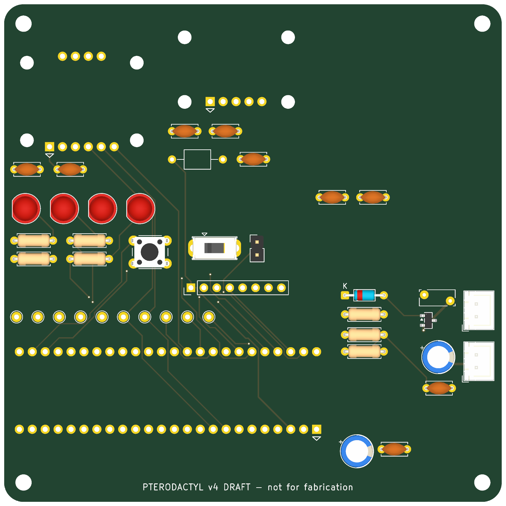

# Step 7 — draft v4 PCB layout

Prepared October 19, 2026. Working branch: `saadat-dev`. Status: **parts placed, ground planes in, not yet routed.** Not for fabrication.

Open `Native_KiCad_v4/PTERODACTYL_v4.kicad_pro` in KiCad 10 and switch to the PCB editor. A top-view render is in [v4-top.png](validation/2026-10-19/step7-pcb/v4-top.png), and an assembly drawing (part outlines and references) in [v4-assembly.pdf](validation/2026-10-19/step7-pcb/v4-assembly.pdf).

## What the board contains

- **Outline:** the legacy 97.79 × 97.79 mm outline with rounded corners (copied from the v3.8 board, A1), and four M3 mounting holes at the legacy positions.
- **Layers:** 4 copper layers. In1.Cu and In2.Cu are solid GND planes, so every GND through-hole pad connects without tracks and all signals get a continuous return path (PC6, PC14). F.Cu and B.Cu are for routing.
- **Parts:** all 49 footprints from the v4 schematic, with nets assigned from the KiCad-exported netlist. Every footprint carries the schematic's fields, and J4 is marked DNP. The board stays linked to the schematic, so *Update PCB from Schematic* works normally.
- **Placement** follows the Step 4 floor plan:
  - BNO055 top-left, MS8607 top-centre, GPS envelope top-right.
  - Teensy along the bottom-left (microSD at the left edge, USB/VIN end toward the power section).
  - Power section in the bottom-right corner, with the battery and switch connectors on the right edge.
  - Middle band: status LEDs, user controls, the spare header and test points.
  - Sensor decoupling capacitors sit next to each module's VIN pin.
- **Net classes:** Default 0.25 mm tracks / 0.2 mm clearance; Power 0.5 mm / 0.25 mm for VBAT_IN, VBAT_FUSED, VBAT_PROT, VBAT_SW, +5V, +3V3 and SENSOR_3V3. These are set in the project file by `tools/generate_v4_schematic.py`.
- **Envelopes:**
  - U5 (GPS) and U2 (regulator) have no verified footprints yet. Each is drawn as a labelled box on F.Fab/F.CrtYd with a rule area that keeps footprints, and on the outer layers tracks and vias, out (PC10). The inner GND planes continue underneath.
  - Their pads are missing, so their nets end short of them.

## Checks

`tools/check_v4_pcb.py` runs native DRC with schematic parity and re-measures the Step 4 separations on the actual placement:

| Check | Result |
| --- | --- |
| DRC violations (all severities) | **0** |
| Schematic parity | Only the 2 expected missing footprints (U2, U5) |
| Unconnected items | 57, expected because nothing is routed yet |
| PC1 BNO055 ↔ power section ≥ 40 mm | 44.4 mm |
| PC2 BNO055 ↔ Teensy ≥ 25 mm | 35.1 mm |
| PC3 BNO055 ↔ GPS ≥ 20 mm | 30.7 mm |
| PC4 GPS ↔ Teensy / power ≥ 20 mm | 30.2 mm / 20.7 mm |
| PC5 MS8607 ↔ Teensy / power ≥ 25 mm | 42.6 mm / 33.8 mm |

Evidence: [pcb-check.json](validation/2026-10-19/step7-pcb/pcb-check.json), [drc.json](validation/2026-10-19/step7-pcb/drc.json).

## How the board is made

`tools/build_v4_pcb.py` (KiCad Python) creates the board from the schematic netlist and a placement table. **It overwrites the board**, so it is only for the pre-routing stage. Once routing or hand edits start, edit the board in KiCad, and use *Update PCB from Schematic* for schematic changes.

## Autorouting attempt (October 19)

`tools/autoroute_v4_pcb.py` exports the board to Specctra DSN, runs Freerouting, imports the session and refills the planes. With Freerouting 2.5.0's Windows CLI build (checksum verified), the routing thread crashed immediately with `UnsupportedFeatureError ... ComponentOutline`, a packaging bug in that native build. The process then idled until it was stopped, and no routes were produced. The board was not modified. Log: [freerouting.log](validation/2026-10-19/step7-pcb/freerouting.log).

The script now stops the router as soon as an exception appears, and passes `--usage_and_diagnostic_data.disable_analytics=true` (the CLI tried to send anonymous usage data; the request was blocked). Next options: the portable `freerouting-2.5.0.jar` with a Java 25 runtime (only Java 17 is installed), or routing by hand. `tools/check_v4_pcb.py` now also reports routing metrics: I2C length (PC11), power-track widths and any tracks inside the U2/U5 envelopes.

## What is not done yet

1. **Routing:** the 57 connections are unrouted. Routing must follow PC6 (supply with return beneath it), PC10 (nothing noisy under the GPS) and PC11 (I2C daisy-chain ≤ 150 mm).
2. **U2 and U5 footprints:** the regulator pinout check and M01 (GPS geometry).
3. **Track widths:** net classes are set (Power 0.5 mm). Confirm them against the manufacturer's rules and the measured currents.
4. **Silkscreen references:** currently on the assembly layer only (F.Fab). Place them on silkscreen during routing.
5. **Manufacturer rules (D08):** minimum track/space, drill sizes and stackup must be set once a fabricator is chosen.
6. **Outer-layer GND pours, stitching vias:** after routing.
7. **3D models for the module footprints:** cosmetic.
8. **Mechanical approval:** M01–M04 and the enclosure (R3, R6).
