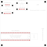

# Step 4 — placement constraints and interference test matrix

Prepared October 19, 2026. Working branch: `saadat-dev`. Status: **draft for team review.** This is a floor plan and set of rules, not a routed layout. Nothing here has been applied to the main schematic or PCB.

## Assumptions

These are working assumptions. Each one changes the plan if it turns out wrong.

| ID | Assumption | Owner / decision |
| --- | --- | --- |
| A1 | The carrier keeps the legacy 97.79 × 97.79 mm outline, with M3 holes 3.81 mm in from each corner. | Enclosure, D06 |
| A2 | In flight, the board is mounted **horizontally, components up**, so the GPS patch antenna faces the sky. | Lead/team. Ask, see [TEAM_LEAD_REQUESTS.md](TEAM_LEAD_REQUESTS.md) |
| A3 | The battery is off-board and connects by cable at the power region edge. | Battery, D02 |
| A4 | The enclosure is vented, not sealed, so the MS8607 sees outside pressure. | Enclosure, D06/D07 |
| A5 | Four copper layers (as in the legacy board), with a continuous ground plane on an inner layer. | Manufacturer, D08 |
| A6 | GPS envelope = product size 34.2 × 25.3 mm plus 1 mm. The exact board is still unverified (M01). | M01 |

## Draft floor plan

Coordinates are board-local mm, origin at the outline's top-left, Y down. Values are courtyard extents from the fixture.

| Block | Position (x0–x1, y0–y1) | Why here |
| --- | --- | --- |
| BNO055 #2472 (U_IMU) | 1.0–29.8, 8.0–30.4, top-left | As far as possible from the power region and battery feed (diagonal corner). |
| MS8607 #4716 (U_ENV) | 32.0–59.5, 3.0–22.9, top-centre | Top edge for a vent, away from Teensy and regulator heat. |
| GPS #5440 envelope (Z_GPS) | 60.5–96.7, 8.0–35.3, top-right | Top band, away from Teensy and power. Nothing tall nearby. |
| Teensy 4.1 (U_MCU), rotated 180° | 0.5–64.5, 65.5–86.5, bottom-left | microSD end at the left board edge, so the card can come out through an enclosure wall. The USB/VIN end faces the power region, keeping the supply feed short. |
| Power region (Z_PWR) | 81.0–96.8, 58.0–88.0, bottom-right | Battery entry, switch, regulator and supply monitor in one corner, 58 mm from the BNO055. |
| Middle band | about y 36–64 | Status LEDs, supply-monitor filter, optional I2C pull-up footprints and test points. Low-power parts only. |

The Teensy's USB access allowance (x 63.4–78.5) stays clear of the power region. The SD access allowance sits beyond the left board edge.

## Placement and routing constraints

Separations are planning targets chosen with the estimates below. They are not manufacturer limits. Tighten or relax them using test results T1–T4.

| ID | Constraint | Basis |
| --- | --- | --- |
| PC1 | BNO055 ≥ 40 mm from the power region. Draft: 58.2 mm. | Magnetic estimate below; inductor fields are not yet known. |
| PC2 | BNO055 ≥ 25 mm from the Teensy. Draft: 35.1 mm. | Teensy/SD supply current. |
| PC3 | BNO055 ≥ 20 mm from the GPS envelope. Draft: 30.7 mm. | GPS current and its CR1220 holder (possibly magnetic metal). |
| PC4 | GPS ≥ 20 mm from the Teensy and from power. Draft: 30.2 mm and 22.7 mm. | Digital and switching noise near the 1575–1606 MHz GPS/GLONASS bands. |
| PC5 | MS8607 ≥ 25 mm from the Teensy and from power. Draft: 42.6 mm and 41.2 mm. | Self-heating of nearby parts biases temperature and humidity. |
| PC6 | **Route every supply current with its return directly beneath it** (a ground plane on the adjacent layer). Twist the battery leads. No supply or switching traces under the BNO055. | Paired currents cancel; see the estimate below. This matters more than distance. |
| PC7 | No ferromagnetic parts within 20 mm of the BNO055: steel screws or spacers, steel-cased cells, inductors, magnets. Check plating on headers and fasteners. | Static distortion reduces calibration quality. |
| PC8 | Mount the BNO055 square to the board edges and record its axis directions for the firmware's axis-remap setting. | Fusion output needs a known mounting orientation. |
| PC9 | Nothing taller than the GPS antenna inside the GPS envelope or directly above it. The enclosure above the GPS must be RF-transparent: no metal, carbon fibre or foil-faced insulation. | Patch antenna needs a sky view. Use the uFL external-antenna option if the enclosure cannot meet this. |
| PC10 | No switching regulator, inductor or SD/clock traces under the GPS envelope. Keep the ground plane under it continuous. | Reduces noise coupling into the receiver. |
| PC11 | Daisy-chain I2C Teensy pin 18/19 → MS8607 → BNO055. Keep SDA/SCL together, over unbroken ground, away from the switching node. Total length ≤ 150 mm. | Bus estimate below. The draft routes about 115–120 mm. |
| PC12 | Route GPS UART (Teensy pins 7/8 → GPS) directly; the row with these pins faces the sensor band in this orientation. | Short, low-speed (9600 baud) link. |
| PC13 | Supply-monitor divider at the power region; RC filter at the Teensy ADC pin. Keep the analog line away from SD and I2C. | Clean battery-voltage readings. |
| PC14 | One continuous ground plane. No split under I2C, UART or the sensors. Resolve the legacy A3V3/AGND labels during Step 5 instead of splitting planes. | Return paths; see SENSOR_CONNECTION_MAP.md. |
| PC15 | Corner holes keep a 4 mm radius clear of courtyards (M3 head/washer). Module courtyards ≥ 0.5 mm from the board edge. | Mechanical. |

## Supporting estimates

**Magnetic field from supply current.** For a single long conductor, B = μ0·I/(2π·r). With an assumed 0.3 A peak (Teensy, sensors and SD write combined; not measured):

| Distance | Unpaired conductor | Paired with return 0.2 mm below | Paired with return 1 mm away |
| ---: | ---: | ---: | ---: |
| 10 mm | 6.0 µT | 0.12 µT | 0.6 µT |
| 25 mm | 2.4 µT | 0.019 µT | 0.096 µT |
| 40 mm | 1.5 µT | 0.0075 µT | 0.038 µT |
| 58 mm | 1.0 µT | 0.0036 µT | 0.018 µT |

Earth's field is about 25–65 µT, and the BNO055 magnetometer resolves about 0.3 µT. An unpaired conductor at 40 mm still moves the reading by about 5 resolution steps whenever the load changes. A paired route at the same distance is far below one step. That is why PC6 is the main control and distance is the backup. Steady offsets calibrate out; changing loads such as SD writes and GPS acquisition do not. Inductors and the battery are not modelled; measure them (T1–T2).

**I2C bus loading.** The draft route is about 115–120 mm. Assume ≤ 150 mm at about 1–1.5 pF/cm, plus roughly 10–20 pF per breakout and the Teensy pin. That totals about 80 pF or less, well under the I2C 400 pF limit. With the two host-side 10 kΩ pull-ups in parallel (5 kΩ), rise time ≈ 0.8473·R·C ≈ 340 ns. That passes standard mode (100 kHz, ≤ 1000 ns) but **exceeds fast mode (400 kHz, ≤ 300 ns)**. Bring up at 100 kHz. Only move to 400 kHz after measuring rise time (T6), using the optional pull-up footprints if needed. The breakouts' level-shifter networks make this an estimate, not a result.

**Heights.** Sensors sit at a proposed 12 mm above the carrier, and the Teensy USB top is at 15.69 mm (see MODULE_ASSEMBLY_PLAN.md). The GPS mounting height is unknown until M01; the product envelope alone is 11.4 mm tall. Size the enclosure's internal height only after M01 and M03 close.

## Interference test matrix (prototype, Step 9)

Pass criteria are proposals for the team to accept or change.

| ID | Source → affected function | Design mitigation | Check on prototype | Proposed pass criterion |
| --- | --- | --- | --- | --- |
| T1 | Load changes (SD writes, GPS acquisition, LEDs) → BNO055 heading | PC1–PC3, PC6 | Board fixed in place; log raw magnetometer at idle, then during SD bursts, GPS cold start and LEDs on | Mean shift < 1 µT per axis between states |
| T2 | Battery, fasteners, enclosure → BNO055 calibration | PC7, A3 | Calibrate inside the final enclosure with the battery fitted; record calibration status and heading against a known reference | Magnetometer calibration reaches 3; heading error recorded and accepted by team |
| T3 | Teensy/SD activity → GPS | PC4, PC10 | Same sky, back-to-back runs: SD logging off, then on. Record time to first fix and GSV signal-to-noise | Mean SNR drop ≤ 2 dB; time to first fix within 20 % |
| T4 | Regulator switching → GPS | PC4, PC10 | Compare a bench linear supply with the battery and regulator under load | As T3 |
| T5 | Startup and SD write surges → supply rails | Power design (Step 5), PC6 | Oscilloscope on VIN and 3.3 V during power-on, SD writes and GPS acquisition | Rails stay inside module limits; no resets or brownouts |
| T6 | Bus capacitance and pull-ups → I2C | PC11 | Scope SDA/SCL rise time at 100 and 400 kHz; count NACKs and errors over a long run | Rise ≤ 1000 ns (100 kHz) or ≤ 300 ns (400 kHz); zero unrecovered errors |
| T7 | Noise → GPS UART | PC12 | Count NMEA checksum failures over a long run | Zero, or logged and recovered |
| T8 | Teensy and regulator heat → MS8607 temperature/humidity | PC5, A4 | In the closed enclosure, compare against a reference thermometer/hygrometer from cold start to steady state | Offset recorded; team accepts value or requires relocation |
| T9 | Enclosure venting → MS8607 pressure | A4 | Compare with a reference barometer; if a vacuum chamber is available, check lag during pump-down | Lag and offset recorded and accepted |
| T10 | Mechanical fit → access and retention | PC15, M01–M04 | Dry-fit in the enclosure: SD removal, USB, GPS sky view, retention under handling | All access works without disassembly beyond the agreed lid removal |
| T11 | Mounting orientation → BNO055 axes | PC8 | Rotate the board about each known axis; confirm sign and axis in the log | Correct after axis-remap configuration |

## Inputs still needed

Added to [TEAM_LEAD_REQUESTS.md](TEAM_LEAD_REQUESTS.md):
- Board orientation in flight (A2).
- Battery type and where it sits in the enclosure (A3).
- Venting, and whether temperature and humidity should be outside-air or internal readings (A4). Outside-air readings need exposure; remote probes were excluded in D01.
- Whether status LEDs must be visible from outside the enclosure.

## Evidence and reproduction

The fixture copies only the legacy outline and hole positions. It places the three draft carrier footprints and two planning boxes, then runs native DRC and the 17 placement checks above. Result: all checks pass, DRC reports zero violations and zero unconnected items. See [placement-check.json](validation/2026-10-19/step4-placement/placement-check.json) and [placement-fixture-drc.json](validation/2026-10-19/step4-placement/placement-fixture-drc.json).

Reproduce with KiCad Python: `"C:\Program Files\KiCad\10.0\bin\python.exe" tools/build_placement_fixture.py`. Pass the kicad-cli path as the first argument if needed.

The fixture is not a circuit, a routed layout or an interference measurement. Separations are checked between rectangular courtyard bounds; field, bus and rise-time numbers are estimates from stated assumptions.

## Step 4 completion state

- [x] Interference sources linked to affected functions and a check for each (T1–T11).
- [x] Draft floor plan, placement and routing rules, with a native fixture check.
- [x] Bus loading and combined pull-up estimate. Recommendation: 100 kHz bring-up.
- [ ] Team review of the floor plan, separation targets and pass criteria.
- [ ] Assumptions A1–A6 confirmed (enclosure, flight orientation, battery, venting, stackup, GPS geometry).

Step 4 planning is drafted. Final placement approval waits on the team review, the assumptions above and the M01–M04 mechanical gates. Step 5 (power design and schematic) can start, using PC6, PC11, PC13 and PC14 as schematic and layout inputs.
